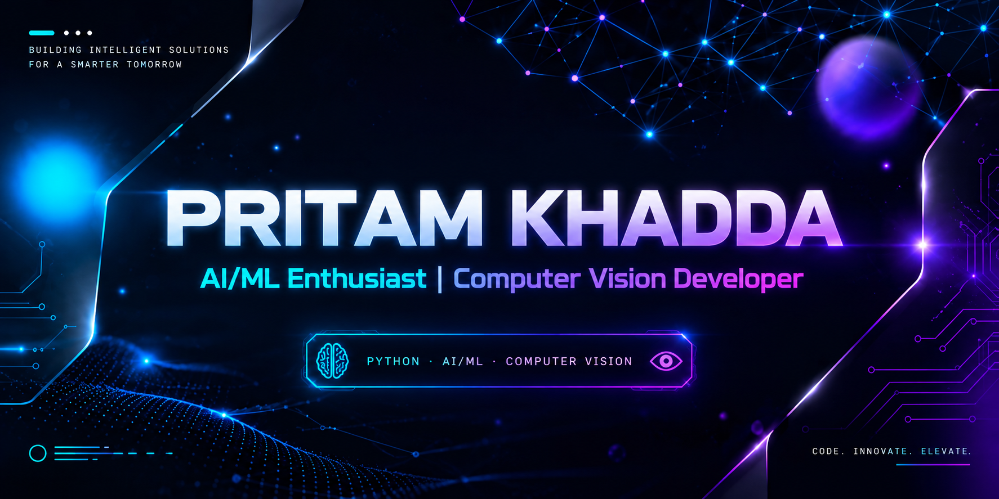

 

  

  <h1>👋 Hi, I'm Pritam Khadda</h1>
  <h3>💜 Aspiring Software Developer | AI/ML & Computer Vision Enthusiast</h3>
  
<b>Building Intelligent Applications with Python & Computer Vision 🚀</b>

  
  

---

<h2 align="center">🧠 About Me</h2>

  <table>
    <tr><td>🎓</td><td>B.Tech student at <b>SIET Nilokheri</b></td></tr>
    <tr><td>🤖</td><td>Interested in Artificial Intelligence and Machine Learning</td></tr>
    <tr><td>👁️</td><td>Exploring Computer Vision and Deep Learning</td></tr>
    <tr><td>🐍</td><td>Building projects using Python, OpenCV, Flask and MediaPipe</td></tr>
    <tr><td>📊</td><td>Learning data analysis with NumPy and Pandas</td></tr>
    <tr><td>🎯</td><td>Working toward becoming an AI/ML Engineer</td></tr>
  </table>

---

<h2 align="center">⚡ Tech Stack & Tools</h2>

<h3 align="center">💻 Programming Languages</h3>

  
  

<h3 align="center">🤖 AI, Machine Learning & Computer Vision</h3>

  
  
  
  

<h3 align="center">📊 Data Analysis</h3>

  
  

<h3 align="center">🌐 Backend & Developer Tools</h3>

  
  
  
  

---

<h2 align="center">🚀 Featured Projects</h2>

<table>
  <tr>
    <td width="50%" valign="top">
      <h3 align="center">🤟 Sign Language Translator</h3>
      
A computer vision and machine learning application that recognizes hand gestures and converts them into text.

      <h4>✨ Key Features</h4>
      <ul>
        <li>Hand landmark detection</li>
        <li>Gesture classification</li>
        <li>Real-time camera input</li>
        <li>Text output and voice support</li>
      </ul>
      
<b>Tech Stack</b>

      
      
      
        
      
    </td>
    <td width="50%" valign="top">
      <h3 align="center">👤 Face Recognition Attendance</h3>
      
A project in development for student face detection, recognition and attendance management.

      <h4>✨ Components</h4>
      <ul>
        <li>Face detection with OpenCV</li>
        <li>Face embeddings for recognition</li>
        <li>Student image collection</li>
        <li>Flask-based capture interface</li>
        <li>Attendance management integration</li>
      </ul>
      
<b>Tech Stack</b>

      
      
      
        
      
    </td>
  </tr>
</table>

---

<h2 align="center">📈 GitHub Statistics</h2>

  
    
  
  

---

<h2 align="center">🐍 Contribution Graph</h2>

  

---

<h2 align="center">🤝 Connect With Me</h2>

  
  

---

  
  
  

  <h3>💜 Keep Learning. Keep Building. Keep Growing.</h3>
  <i>Turning ideas into intelligent solutions, one project at a time. 🚀</i>

